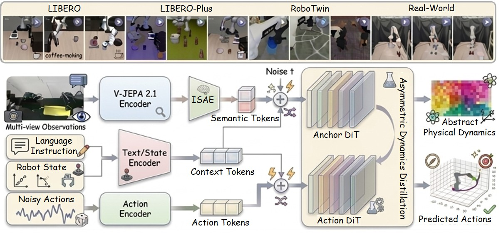
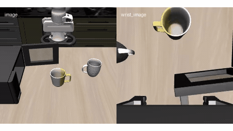
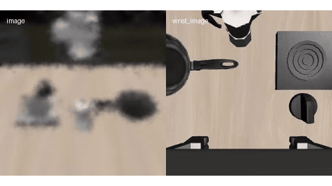
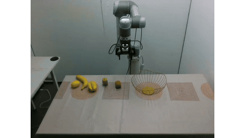

<div align="center">

# LeapBot-WA

### World-Anchor Action Models via Predictive Latent Alignments

**Pei Liu<sup>1,2,*</sup> · Nan Zheng<sup>3,*</sup> · Lang Zhang<sup>3,*,†</sup> · Daojie Peng<sup>1</sup> · Yanan Zhang<sup>3</sup> · Feilong Kong<sup>4</sup>**<br>
**Mingyue Feng<sup>3</sup> · Jiachao Liu<sup>3</sup> · Yaonong Wang<sup>3</sup> · Qifeng Chen<sup>2</sup> · Jun Ma<sup>1,2,‡</sup>**

<sup>1</sup> The Hong Kong University of Science and Technology (Guangzhou)<br>
<sup>2</sup> The Hong Kong University of Science and Technology<br>
<sup>3</sup> Leapmotor &nbsp;&nbsp; <sup>4</sup> Southeast University

<sup>*</sup> Equal contribution. &nbsp; <sup>†</sup> Project leader. &nbsp; <sup>‡</sup> Corresponding author.

[](https://arxiv.org/abs/2607.23969)
[](https://www.alphaxiv.org/abs/2607.23969)
[](https://huggingface.co/NanZheng77/LeapBot-WA)

**Learning predictive world dynamics for efficient robotic control.**

</div>

Official repository for [**LeapBot-WA: World-Anchor Action Models via Predictive Latent Alignments**](https://arxiv.org/abs/2607.23969).

> **Inference code and model weights are available.** The PyTorch inference implementation is available in [`leapbot_wa/`](leapbot_wa/) with LIBERO and RoboTwin simulation evaluation instructions below. Model weights are available on [Hugging Face](https://huggingface.co/NanZheng77/LeapBot-WA). Training code is outside the release scope.

[News](#news) · [Overview](#overview) · [Demos](#demos) · [Release Status](#release-status) · [Getting Started](#getting-started) · [Environment](#environment-setup) · [LIBERO](#libero) · [RoboTwin](#robotwin) · [Citation](#citation)

## News

- **2026/09/08:** Added the model architecture and demonstrations from LIBERO, LIBERO-Plus, RoboTwin, and real-world manipulation.
- **2026/07/30:** Updated paper available on [arXiv](https://arxiv.org/abs/2607.23969v2).

## Overview

LeapBot-WA learns robotic actions through predictive semantic alignment in a latent space. It uses a Joint-Embedding Predictive Architecture (JEPA) as a **World-Anchor**, providing physical dynamics guidance without pixel-level video generation.

The method combines three components:

- **Predictive World-Anchor:** JEPA features provide semantic representations of the environment and its dynamics.
- **Isotropic Semantic Autoencoder (ISAE):** Maps predictive features into a latent space suited to diffusion modeling.
- **Asymmetric Mixture-of-Transformers (MoT):** An Anchor Diffusion Transformer guides an Action Diffusion Transformer during training. The heavy dynamics branch is pruned at inference for efficient action generation.

The [paper](https://arxiv.org/abs/2607.23969) evaluates LeapBot-WA on LIBERO, RoboTwin 2.0, unseen visual conditions, and real-world robotic manipulation.

<div align="center">
  <a href="assets/images/main_wam2.jpg">
    
  </a>
  <p><strong>LeapBot-WA architecture.</strong> Visual features and language/state context condition the action model. The Anchor DiT supplies dynamics guidance during training and is omitted at inference. Click the figure to enlarge.</p>
</div>

## Demos

The animations below are lightweight previews (up to 12 seconds). **Click a preview or its video link to open the full MP4.**

<table>
  <tr>
    <td width="50%" align="center" valign="top">
      <h3>LIBERO</h3>
      <a href="assets/videos/leapbot-wa-video2.mp4"></a>
      <p>Simulated manipulation with external and wrist camera views.</p>
      <a href="assets/videos/leapbot-wa-video2.mp4">Watch full video</a>
    </td>
    <td width="50%" align="center" valign="top">
      <h3>LIBERO-Plus</h3>
      <a href="assets/videos/leapbot-wa-video3.mp4"></a>
      <p>Manipulation under visual perturbations.</p>
      <a href="assets/videos/leapbot-wa-video3.mp4">Watch full video</a>
    </td>
  </tr>
  <tr>
    <td width="50%" align="center" valign="top">
      <h3>RoboTwin</h3>
      <a href="assets/videos/robotwin-demo.mp4"></a>
      <p>Multi-view robotic manipulation in simulation.</p>
      <a href="assets/videos/robotwin-demo.mp4">Watch full video</a>
    </td>
    <td width="50%" align="center" valign="top">
      <h3>Real-World Manipulation</h3>
      <a href="assets/videos/leapbot-wa-video1.mp4"></a>
      <p>Tabletop manipulation on a physical robot.</p>
      <a href="assets/videos/leapbot-wa-video1.mp4">Watch full video</a>
    </td>
  </tr>
</table>

## Release Status

- [x] Paper available on [arXiv](https://arxiv.org/abs/2607.23969) and [alphaXiv](https://www.alphaxiv.org/abs/2607.23969).
- [x] Project README.
- [x] Model architecture and demonstration videos.
- [x] PyTorch inference source.
- [x] Environment setup baseline and model asset checklist.
- [x] One-episode LIBERO GPU smoke test (2026/10/14).
- [ ] Clean-environment verification and full benchmark reproduction.
- [x] LIBERO closed-loop evaluation and RoboTwin simulator policy/launcher.
- [x] Released model downloads and per-benchmark setup instructions.

## Getting Started

This release runs LIBERO and RoboTwin simulation evaluation directly. It contains
one model architecture: the mixed V-JEPA2.1 encoder, mixed adapter, and JEPA/action
MoT. Architecture ablation switches are not exposed in the evaluation configs.
Run the commands below from the repository root (`leapbot-wa/`). Install the
common environment first, then follow either benchmark section from preparation
through evaluation. All setup instructions are collected in this README.

## Environment Setup

The local CPU regression baseline is Python 3.10, PyTorch 2.7.1,
torchvision 0.22.1, and CUDA 12.6 PyTorch wheels. This is not yet a verified
clean-install or GPU benchmark environment. On Linux with an NVIDIA GPU:

```bash
conda create -n leapbot-wa python=3.10 -y
conda activate leapbot-wa
pip install --upgrade pip
pip install torch==2.7.1 torchvision==0.22.1 --index-url https://download.pytorch.org/whl/cu126
pip install -r requirements-inference.txt
```

The wheel pairing follows the [official PyTorch installation matrix](https://pytorch.org/get-started/previous-versions/).
`huggingface_hub` is installed as a Transformers dependency and supplies the
download function used below. The requirements file pins the model packages and LIBERO simulation dependencies; simulator dependencies
must also be installed. No editable package installation is needed for the scripts.

Configuration and CPU regression checks (no policy weights or simulator needed):

```bash
python experiments/libero/eval_libero_single.py --cfg job --resolve
python experiments/robotwin/eval_robotwin_single.py --cfg job --resolve
OMP_NUM_THREADS=1 python -m unittest discover -s tests -v
```

## Code organization

```text
experiments/libero/eval_libero_single.py           # LIBERO evaluation loop
experiments/libero/libero_utils.py                 # Environment and image helpers
experiments/robotwin/eval_robotwin_single.py        # RoboTwin evaluation launcher
experiments/robotwin/leapbot_wa_policy/             # RoboTwin-required policy plugin
leapbot_wa/runtime.py                              # Model construction
leapbot_wa/models/                                 # Model and checkpoint loading
leapbot_wa/datasets/lerobot/                        # Processors and normalization
configs/sim_libero.yaml                            # LIBERO evaluation settings
configs/sim_robotwin.yaml                          # RoboTwin evaluation settings
```

Evaluation scripts instantiate the model and processor, load the checkpoint,
and call the model's existing `infer_action` method inside the simulator loop.
The RoboTwin plugin is the interface required by its evaluator. There is no
additional observation-level inference package or server.

Set rollout and sampling parameters directly in `EVALUATION`, as in the reference
project. The base `libero.yaml` and `robotwin.yaml` hold model/processor settings;
the simulator configs compose these without a training configuration hierarchy.

## LIBERO

### Prepare the environment

First install the model dependencies in [Environment Setup](#environment-setup).
Install [LIBERO](https://github.com/Lifelong-Robot-Learning/LIBERO)
and its scene assets, BDDL files, and initial states into this environment.
The local reference uses MuJoCo 3.3.2 and robosuite 1.4.0; its LIBERO checkout
is based on commit `8f1084e3132a39270c3a13ebe37270a43ece2a01`.
Local checkout modifications and compatibility with a clean upstream installation
still need verification. Older simulator requirements pin conflicting Hydra/einops
versions; preserve this repository's model requirements when resolving dependencies.
For headless MuJoCo rendering, configure the machine's EGL backend, for example
`export MUJOCO_GL=egl`. Verify `import libero.libero` in the active environment.

The LIBERO simulation dependencies, including BDDL's `future` dependency, are
listed in `requirements-inference.txt`. Install them in the active `leapbot-wa`
environment:

```bash
python -m pip install -r requirements-inference.txt
python -m pip install --no-deps -e /path/to/LIBERO
export LIBERO_CONFIG_PATH="$PWD/.libero"
export MUJOCO_GL=egl
python -c "from libero.libero.envs import OffScreenRenderEnv; print('LIBERO simulator import OK')"
```

Replace `/path/to/LIBERO` with your checkout. On its first import, answer `N` to
use the default dataset path. Simulation evaluation needs the scene assets,
BDDL files, and initial states, but does not require training datasets. The
missing `datasets` directory warning alone does not prevent evaluation.
Keep `LIBERO_CONFIG_PATH` and `MUJOCO_GL` set when starting evaluation. Installing
with `--no-deps` avoids the older Hydra/einops pins in LIBERO's requirements.
A shared editable checkout is usable, but source changes affect every environment
using that checkout; the separate configuration directory isolates path settings.

LIBERO and its simulator dependencies must be importable, with its BDDL, initial
states, and scene assets configured in the LIBERO installation.

### Prepare the weights

For LIBERO, prepare only the assets below. Run all commands from this repository's
root. Download from [NanZheng77/LeapBot-WA](https://huggingface.co/NanZheng77/LeapBot-WA) and keep filenames unchanged.
Sizes are decimal GB of the files, not GPU memory requirements.

| Asset | Size | Download | Destination |
|---|---:|---|---|
| LIBERO policy | 5.49 GB | [Download](https://huggingface.co/NanZheng77/LeapBot-WA/resolve/14c371909dd61d6614e37fc3d99c7f7ebc67e013/leapbotwa-libero.pt?download=true) | `weights/leapbotwa-libero.pt` |
| Mixed V-JEPA2.1 encoder | 15.54 GB | [Download](https://huggingface.co/NanZheng77/LeapBot-WA/resolve/14c371909dd61d6614e37fc3d99c7f7ebc67e013/vjepa_latest.pt?download=true) | `weights/vjepa_latest.pt` |
| Mixed adapter | 1.30 GB | [Download](https://huggingface.co/NanZheng77/LeapBot-WA/resolve/14c371909dd61d6614e37fc3d99c7f7ebc67e013/adapter_latest.pt?download=true) | `weights/adapter_latest.pt` |
| UMT5 text encoder | 11.36 GB | [Wan-AI download](https://huggingface.co/Wan-AI/Wan2.1-I2V-14B-480P/resolve/main/models_t5_umt5-xxl-enc-bf16.pth?download=true) | `weights/models_t5_umt5-xxl-enc-bf16.pth` |
| UMT5 tokenizer | ~21 MB | [Wan-AI files](https://huggingface.co/Wan-AI/Wan2.1-I2V-14B-480P/tree/main/google/umt5-xxl) | `weights/google/umt5-xxl/` |
| Evaluation statistics | Included | [JSON](configs/stats/libero_dataset_stats.json) | `configs/stats/libero_dataset_stats.json` |

1. Create the destination with `mkdir -p weights/google/umt5-xxl`.
2. Run the download block below. It places this benchmark's policy, mixed encoder,
   mixed adapter, and Wan text assets directly into `weights/`. No manual move or
   filename change is needed.
3. If already prepared for the other benchmark, reuse the same `weights/` directory;
   the shared files do not need a second copy.
4. Keep the included LIBERO statistics unchanged: they are byte-for-byte copies
   of the original evaluation files. No training dataset or recalculation is needed.

```bash
python - <<'PYTHON'
from huggingface_hub import snapshot_download

snapshot_download(
    repo_id="NanZheng77/LeapBot-WA",
    revision="14c371909dd61d6614e37fc3d99c7f7ebc67e013",
    allow_patterns=[
        "leapbotwa-libero.pt",
        "vjepa_latest.pt",
        "adapter_latest.pt",
    ],
    local_dir="weights",
)

snapshot_download(
    repo_id="Wan-AI/Wan2.1-I2V-14B-480P",
    allow_patterns=[
        "models_t5_umt5-xxl-enc-bf16.pth",
        "google/umt5-xxl/*",
    ],
    local_dir="weights",
)
PYTHON
```

The tokenizer directory must contain `tokenizer.json`, `tokenizer_config.json`,
`special_tokens_map.json`, and `spiece.model`. Only this benchmark's policy and shared inference assets are downloaded; the Wan
video DiT, VAE, and separate training initialization weights are not needed.

The policy download is pinned to release revision `14c371909dd61d6614e37fc3d99c7f7ebc67e013`.
The expected paths are:

```text
weights/
├── leapbotwa-libero.pt
├── vjepa_latest.pt
├── adapter_latest.pt
├── models_t5_umt5-xxl-enc-bf16.pth
└── google/umt5-xxl/
    ├── tokenizer.json
    ├── tokenizer_config.json
    ├── special_tokens_map.json
    └── spiece.model
```

The loader uses the `weights/` paths above by default. These environment variables
are optional overrides, useful for reusing assets stored elsewhere:

```bash
export LEAPBOT_WA_VJEPA_CHECKPOINT="$PWD/weights/vjepa_latest.pt"
export LEAPBOT_WA_ADAPTER_CHECKPOINT="$PWD/weights/adapter_latest.pt"
export LEAPBOT_WA_TEXT_ENCODER="$PWD/weights/models_t5_umt5-xxl-enc-bf16.pth"
export LEAPBOT_WA_TOKENIZER="$PWD/weights/google/umt5-xxl"
```

### Run evaluation

For an initial setup check, run the command below with the episode count reduced
to `1` (`EVALUATION.num_trials=1` for LIBERO or
`EVALUATION.eval_num_episodes=1` for RoboTwin). Restore `50` for evaluation.

```bash
python experiments/libero/eval_libero_single.py \
  ckpt=./weights/leapbotwa-libero.pt \
  EVALUATION.dataset_stats_path=./configs/stats/libero_dataset_stats.json \
  EVALUATION.task_suite_name=libero_spatial \
  EVALUATION.task_id=0 \
  EVALUATION.num_trials=50 \
  EVALUATION.output_dir=./evaluate_results/libero/run01 \
  gpu_id=0
```

The loop retains the reference evaluation behavior:

1. Reset the environment and set the task's stored initial state.
2. Execute 30 settling/no-op steps by default.
3. Rotate simulator images 180 degrees, resize/crop the two views, and normalize
   the state. Infer an action chunk with 10 denoising steps by default.
4. Invert normalization and convert the gripper convention from the dataset to
   LIBERO. Optional binarization and temporal action ensembling are supported.
5. Execute the first 10 actions by default, then re-observe and replan.
6. Stop on success or at the reference suite step limit; save per-task success
   counts, episode IDs, duration, and optional rollout videos.

Results are written to:

```text
<output_dir>/config_<suite>_<task_id>.yaml
<output_dir>/<suite>/gpu<gpu_id>_task<task_id>_results.json
<output_dir>/<suite>/videos/*.mp4
```

Supported suite limits: 400 steps for spatial/object/goal, 700 for libero_10/90,
plus the settling steps. If more trials than initial states are requested, states
are reused in their original order. `EVALUATION.replan_steps` must be between 1
and the action horizon. This is a single-task entrypoint; task scheduling across
multiple GPUs is not included.

## RoboTwin

### Prepare the environment

First install the model dependencies in [Environment Setup](#environment-setup).
Follow the [official installation and asset instructions](https://robotwin-platform.github.io/doc/usage/robotwin-install.html)
for the simulator dependencies, then install this repository's model requirements
in the same environment. Use separate LIBERO/RoboTwin conda environments if needed.
Our launcher requires the `script/eval_policy.py --config/--overrides` evaluator,
including `eval_num_episodes`, `eval_output_dir`, and `expert_check` options.
The local reference contains evaluator customizations; a compatible public
revision or patch is still required before claiming an out-of-the-box release.

Use a compatible RoboTwin 2.0 checkout with the `script/eval_policy.py`
`--config/--overrides` policy interface used by the reference evaluation. That checkout
supplies environment creation, scene randomization, episode instructions,
success detection, and result/video recording. This repository supplies the
launcher and the `get_model`, `eval`, `reset_model` policy plugin.

### Prepare the weights

For RoboTwin, prepare only the assets below. Run all commands from this repository's
root. Download from [NanZheng77/LeapBot-WA](https://huggingface.co/NanZheng77/LeapBot-WA) and keep filenames unchanged.
Sizes are decimal GB of the files, not GPU memory requirements.

| Asset | Size | Download | Destination |
|---|---:|---|---|
| RoboTwin policy | 5.49 GB | [Download](https://huggingface.co/NanZheng77/LeapBot-WA/resolve/14c371909dd61d6614e37fc3d99c7f7ebc67e013/leapbotwa-robotwin.pt?download=true) | `weights/leapbotwa-robotwin.pt` |
| Mixed V-JEPA2.1 encoder | 15.54 GB | [Download](https://huggingface.co/NanZheng77/LeapBot-WA/resolve/14c371909dd61d6614e37fc3d99c7f7ebc67e013/vjepa_latest.pt?download=true) | `weights/vjepa_latest.pt` |
| Mixed adapter | 1.30 GB | [Download](https://huggingface.co/NanZheng77/LeapBot-WA/resolve/14c371909dd61d6614e37fc3d99c7f7ebc67e013/adapter_latest.pt?download=true) | `weights/adapter_latest.pt` |
| UMT5 text encoder | 11.36 GB | [Wan-AI download](https://huggingface.co/Wan-AI/Wan2.1-I2V-14B-480P/resolve/main/models_t5_umt5-xxl-enc-bf16.pth?download=true) | `weights/models_t5_umt5-xxl-enc-bf16.pth` |
| UMT5 tokenizer | ~21 MB | [Wan-AI files](https://huggingface.co/Wan-AI/Wan2.1-I2V-14B-480P/tree/main/google/umt5-xxl) | `weights/google/umt5-xxl/` |
| Evaluation statistics | Included | [JSON](configs/stats/robotwin_dataset_stats.json) | `configs/stats/robotwin_dataset_stats.json` |

1. Create the destination with `mkdir -p weights/google/umt5-xxl`.
2. Run the download block below. It places this benchmark's policy, mixed encoder,
   mixed adapter, and Wan text assets directly into `weights/`. No manual move or
   filename change is needed.
3. If already prepared for the other benchmark, reuse the same `weights/` directory;
   the shared files do not need a second copy.
4. Keep the included RoboTwin statistics unchanged: they are byte-for-byte copies
   of the original evaluation files. No training dataset or recalculation is needed.

```bash
python - <<'PYTHON'
from huggingface_hub import snapshot_download

snapshot_download(
    repo_id="NanZheng77/LeapBot-WA",
    revision="14c371909dd61d6614e37fc3d99c7f7ebc67e013",
    allow_patterns=[
        "leapbotwa-robotwin.pt",
        "vjepa_latest.pt",
        "adapter_latest.pt",
    ],
    local_dir="weights",
)

snapshot_download(
    repo_id="Wan-AI/Wan2.1-I2V-14B-480P",
    allow_patterns=[
        "models_t5_umt5-xxl-enc-bf16.pth",
        "google/umt5-xxl/*",
    ],
    local_dir="weights",
)
PYTHON
```

The tokenizer directory must contain `tokenizer.json`, `tokenizer_config.json`,
`special_tokens_map.json`, and `spiece.model`. Only this benchmark's policy and shared inference assets are downloaded; the Wan
video DiT, VAE, and separate training initialization weights are not needed.

The policy download is pinned to release revision `14c371909dd61d6614e37fc3d99c7f7ebc67e013`.
The expected paths are:

```text
weights/
├── leapbotwa-robotwin.pt
├── vjepa_latest.pt
├── adapter_latest.pt
├── models_t5_umt5-xxl-enc-bf16.pth
└── google/umt5-xxl/
    ├── tokenizer.json
    ├── tokenizer_config.json
    ├── special_tokens_map.json
    └── spiece.model
```

The loader uses the `weights/` paths above by default. These environment variables
are optional overrides, useful for reusing assets stored elsewhere:

```bash
export LEAPBOT_WA_VJEPA_CHECKPOINT="$PWD/weights/vjepa_latest.pt"
export LEAPBOT_WA_ADAPTER_CHECKPOINT="$PWD/weights/adapter_latest.pt"
export LEAPBOT_WA_TEXT_ENCODER="$PWD/weights/models_t5_umt5-xxl-enc-bf16.pth"
export LEAPBOT_WA_TOKENIZER="$PWD/weights/google/umt5-xxl"
```

### Run evaluation

For an initial setup check, run the command below with the episode count reduced
to `1` (`EVALUATION.num_trials=1` for LIBERO or
`EVALUATION.eval_num_episodes=1` for RoboTwin). Restore `50` for evaluation.

```bash
python experiments/robotwin/eval_robotwin_single.py \
  ckpt=./weights/leapbotwa-robotwin.pt \
  EVALUATION.dataset_stats_path=./configs/stats/robotwin_dataset_stats.json \
  EVALUATION.robotwin_root=/path/to/RoboTwin \
  EVALUATION.task_name=click_alarmclock \
  EVALUATION.task_config=demo_randomized \
  EVALUATION.eval_num_episodes=50 \
  EVALUATION.output_dir=./evaluate_results/robotwin/run01 \
  gpu_id=0
```

`LEAPBOT_WA_ROBOTWIN_ROOT` can provide the simulator root instead. The launcher
adds the model repository and policy-plugin directory to the child process's
`PYTHONPATH`; no policy symlink is required. The evaluator must still meet the
compatibility requirements listed above.

The policy preserves the reference head/left-wrist/right-wrist ordering,
bicubic 320×240 resize, state/action normalization, and `take_action(...,
action_type="qpos")`. It runs 10 denoising steps and executes up to 24 actions
per replan by default, clearing the queue at every episode reset. These can be
set via `EVALUATION.num_inference_steps` and `EVALUATION.replan_steps`.

Benchmark defaults enable `expert_check` and disable rollout-data collection.
The local reference's custom data-collection options are not part of this
release. Simulator task configuration controls video recording. The simulator
version must support the forwarded `eval_num_episodes`, `eval_output_dir`, and
`expert_check` options; a publicly reproducible simulator revision remains to be pinned.

The launcher writes a resolved `sim_config.yaml` and `eval.log` under
`<output_dir>/<task_name>/`, and directs simulator results there. In the reference
RoboTwin version the summary is `_result_clean.txt` or `_result_random.txt`.
Nonzero simulator exit status causes the launcher to fail and retain the log.

## Validation scope

CPU tests use stand-in simulator environments to verify settling steps, action
queues, gripper conversion, episode resets, qpos commands, result serialization,
and configuration/argument forwarding. The LIBERO model inputs and final control
actions were compared against the reference implementation for both supported
gripper encodings. The RoboTwin normalization, view preprocessing, action
inference, queue-filling, and reset methods retain their reference implementation.

A one-episode LIBERO GPU smoke test completed on 2026/10/14 in the local
`leapbot-wa` environment using the released assets. This verifies the local
loading and simulation execution flow. Full benchmark success-rate reproduction,
a clean upstream simulator installation, and an end-to-end RoboTwin rollout
have not yet been verified.


## Citation

If you find this work useful, please cite:

```bibtex
@misc{liu2026leapbotwaworldanchoractionmodels,
  title         = {LeapBot-WA: World-Anchor Action Models via Predictive Latent Alignments},
  author        = {Pei Liu and Nan Zheng and Lang Zhang and Daojie Peng and Yanan Zhang and Feilong Kong and Mingyue Feng and Jiachao Liu and Yaonong Wang and Qifeng Chen and Jun Ma},
  year          = {2026},
  eprint        = {2607.23969},
  archivePrefix = {arXiv},
  primaryClass  = {cs.RO},
  url           = {https://arxiv.org/abs/2607.23969}
}
```
